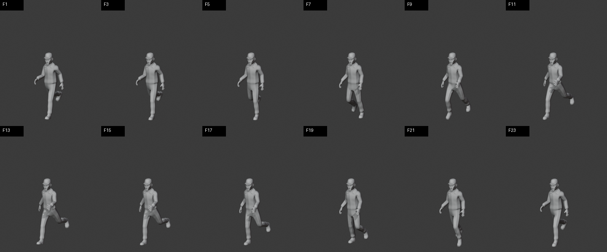

# Unity MCP Animation Lab

Экспериментальный Unity-проект, в котором Codex управляет Unity и Blender через MCP: подготавливает модель, генерирует и корректирует анимации ходьбы и бега, подключает контроллер и выполняет визуальную проверку с нескольких ракурсов.

## Что сделано

- интеграция Unity MCP в проект Unity 6;
- подготовка и импорт персонажа из Blender/FBX;
- генератор walk-анимации в Unity Editor;
- контроллер движения и камера сопровождения;
- тесты движения вперёд, назад, влево и вправо;
- набор кадров и коротких MP4-превью для визуального QA.

## Стек

`Unity 6` · `C#` · `Blender` · `FBX` · `Unity MCP` · `Codex`

## Открытие проекта

1. Установите Unity `6000.5.6f1` или совместимую версию.
2. Откройте каталог проекта через Unity Hub.
3. Дождитесь восстановления пакетов.
4. Запустите `Assets/Scenes/SampleScene.unity`.

Сгенерированные `Library`, `Logs`, IDE-файлы и длинные последовательности QA-кадров не входят в репозиторий.

## Статус

R&D-кейс. Основной результат — воспроизводимый пайплайн управления сценой и анимациями через MCP, а не законченная игра.

## Работа с изменениями и безопасность

Ветки задач, проверки CI, локальный Gitleaks и правила работы с секретами описаны в [CONTRIBUTING.md](CONTRIBUTING.md). Настройки внешних сервисов передаются через локальные env-файлы или secret-хранилище платформы деплоя.
